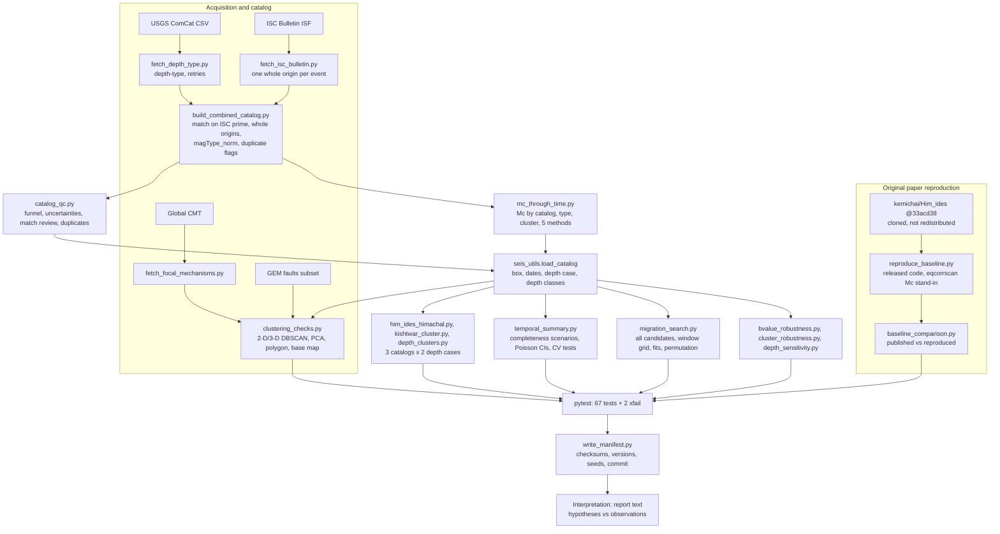

# Final audit: scientific, methodological and code validation

Branch `audit/final-scientific-validation`, from `audit/qc-and-fixes` (e2e7825), 2026-11-24. Not merged into `main`.
Per-task evidence: `TASK_STATUS.csv` (85 rows, initial and final status). Numbers: `BEFORE_AFTER_RESULTS.csv`.
Companion files: `PAPER_METHOD_COMPARISON.md`, `SCIENTIFIC_ASSUMPTIONS.md`, `TEST_REPORT.md`, `REPRODUCIBILITY.md`,
`CHANGELOG.md`, `INITIAL_AUDIT.md`.

## 1. Outcome in numbers

| | Tasks |
|---|---|
| Complete before the audit (and still complete) | 7 |
| Incorrect before, corrected | 10 |
| Not implemented before, now complete | 18 (4 more now partial) |
| Partially complete before, now complete | 34 |
| Partially complete at the end | 13 |
| Not applicable (with evidence) | 2 (42 space-time clustering, 62 migration plots) |
| Blocked by data | 1 (53 Omori: no sequence) |

Final: **69 complete, 13 partially complete, 2 not applicable, 1 blocked**.

The paper was read from its PDF (Front. Earth Sci. 9:742700). Every published value in this audit was checked against that text.

## 2. Most important findings

1. **Cluster 1 Mc 2.85 cannot come from the released code** (Task 1). `calc_max_curv` uses 0.5-magnitude bins, so Mc + 0.4 can only end in .4 or .9. Cluster 1 gives 2.4 for every origin choice. The b-value is reproduced once the published threshold is used: least squares 0.942 and maximum likelihood 0.976 ± 0.13 against the published 0.96 (Task 2). Cluster 1 has 254 events against the published 248: the released polygons differ from the "box in Figure 2". These discrepancies are recorded, not tuned away.
2. **Mixed hypocentres** (Task 8). 187 combined events had a USGS epicentre with an ISC depth, and ISC-only events mixed agencies. Every row now comes from one whole origin. The combined intermediate count since 1990 changed from 55 to 50 and the Kishtwar outline from 19 to 17.
3. **M 4.4 is not complete for 1990-1999 in USGS** (Task 23). The authors' method gives 4.9. M 4.4 is now labelled exploratory, and every rate carries a completeness flag.
4. **The Kishtwar "intermediate" cluster is fragile in depth** (Tasks 20, 67, 68).
   - It almost disappears when the lower bound moves from 40 to 50 km: 11 → 3 (USGS) and 17 → 5 (combined).
   - The regional crust is about 44-54 km thick (Sharma et al. 2018).
   - Global CMT centroids are all at 41 km or shallower. The one catalog "intermediate" event with a GCMT solution (catalog 49.9 km) has a centroid at 25 km.
   - The catalog therefore cannot show whether these events are lower-crustal or mantle, or whether some depths are overestimated.
5. **No intermediate-depth sequence or migration** (Tasks 54-63). This holds for every window from 5 days/10 km to 60 days/50 km, in every catalog. It is a detection limit, not proof that migration is absent.
6. **Temporal behaviour of intermediate events is not distinguishable from a stationary Poisson process** (Tasks 43-50). This holds under every completeness scenario, with CV-test p-values of 0.03-0.65 and only 5-32 events. All-event catalogs are over-dispersed (CV 1.35-1.40, p < 0.01), which reflects aftershocks and changing completeness.
7. **The band survives location errors only under the 1σ reading of the errors** (Tasks 39-41). Recovery of at least 90% of its events in one cluster is 68% (combined) and 79% (USGS) with errors read as 1σ, but only 4-15% if errors are twice as large. The best-matching cluster is heavily contaminated (median 80% outsiders in the combined catalog).
8. **Code errors fixed:**
   - transitive duplicate chains;
   - duplicate flags reported at event level instead of pair level;
   - Båth's law applied to unrelated events;
   - candidate sequences discarded before being saved;
   - missing depth errors treated as zero;
   - degrees and km mixed in the 3-D plot;
   - failed metadata requests never retried;
   - the pipeline continuing after failures;
   - `--quick` not doing what it says;
   - a malformed baseline CSV (unquoted commas);
   - an unclosed file in the parser.
9. **Licensing** (Task 85). Upstream has no licence and our repository is public. This branch no longer tracks `Him_ides/`; it is cloned at 33acd38 when needed. The copy is still in the history and on `main`, so this is not resolved.

## 3. Remaining limitations (not fixed, stated)

- The published Cluster 1 Mc (2.85) and count (248) are unresolved: the code that produced them is not public. The paper's 4 migration sequences can't be reproduced either: the search code is not released.
- The USGS/ISC uncertainty definitions are unverified. The documentation fetch failed, so the 1σ reading is an assumption, tested against alternatives.
- GFT and MBS completeness are mostly undefined: the magnitude distributions are not clean G-R populations. The cause of the b-cutoff dependence is unknown.
- b-values remain uncertain: N is small, the scales are mixed in the combined catalog, and temporal dependence is ignored in the bootstrap.
- No topography layer. The GEM fault coverage of the Indian NW Himalaya is incomplete. No gridded Moho model is used.
- CI has not been executed on GitHub (branch not pushed). Network outages are not modelled.

## 4. Answers to the brief

- **Original catalog-based methodology reproduced?** Mostly. Released code runs unchanged; full-catalog N, Mc and (within 0.8 %) b match; Cluster 2 N matches; Cluster 1 b matches at the published Mc. Cluster 1 Mc/N and the migration search are not reproducible from released material.
- **AI/ML appropriate?** DBSCAN is used as a descriptive density-clustering tool with explicit settings checks, 3-D comparison, k-distance plot and joint error propagation - appropriate as long as clusters are not presented as structures. Space-time clustering was tested for feasibility and rejected (too sparse).
- **Workflow correct?** The pipeline is dependency-ordered, fails safely, is reproducible (two runs identical) and installs cleanly on Python 3.12; 67 tests pass, 2 documented expected failures.
- **Ready for academic submission?** The code and results are ready to support a report, provided the report states the limitations above: depth reliability of the 40-60 km events, completeness, small samples, and the unreproduced published values. The licensing question must be settled before the repository stays public.

## 5. Workflow

